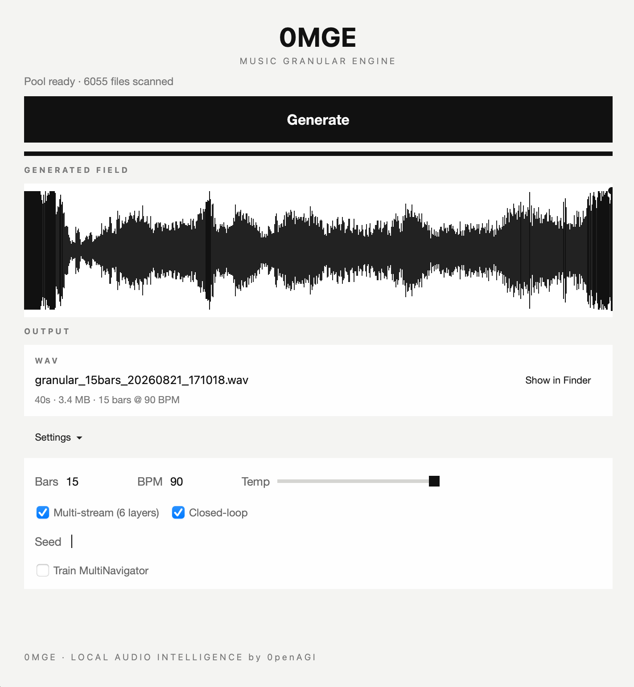
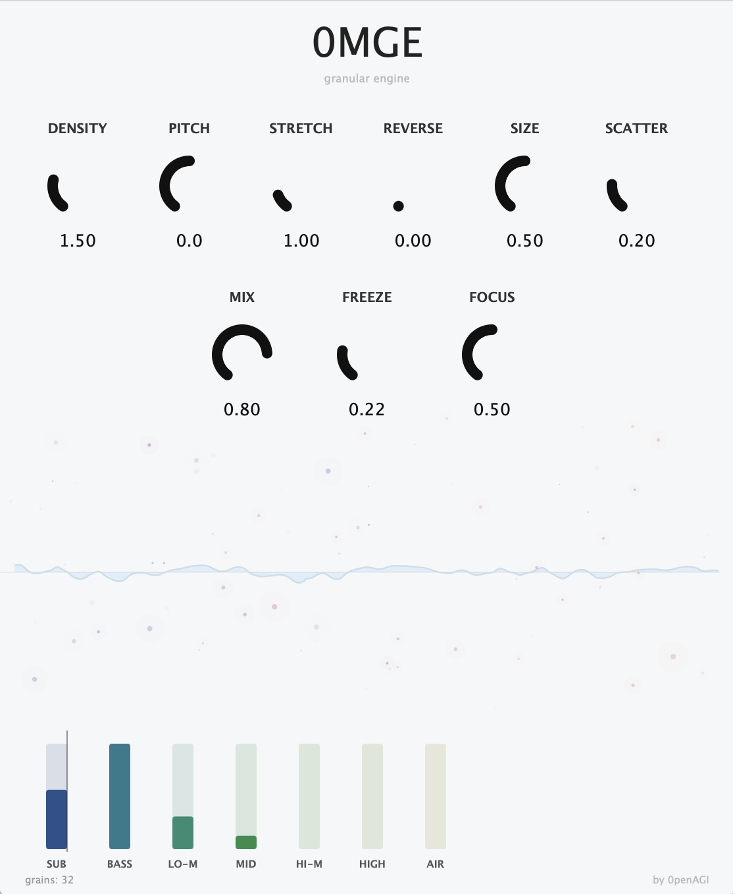
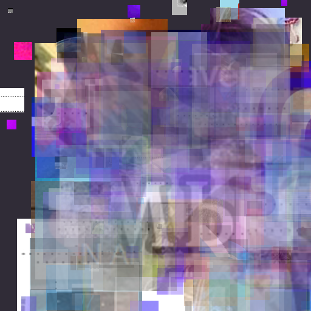

# 0MGE — Neural Granular Engine

> **AI music generation from YOUR music.** No cloud. No API. No subscription. Runs entirely on your machine.

[](LICENSE)
[](https://python.org)
[](https://pytorch.org)
[]()
[](https://huggingface.co/0penAGI/0MGE)
[](https://0penagi.github.io/0MGE/)

A neural network that learns from YOUR music and generates new sound. Launch the app, point it at your music folder — it scans, trains, and generates. All locally.

**[Listen to demo](https://0penagi.github.io/0MGE/)** · **[Download models](https://huggingface.co/0penAGI/0MGE)** · **[VST Plugin](#vst3au-plugin)**

---

## What is 0MGE?

0MGE is a **neural granular engine** — it scans your music library, extracts millions of micro-grains (tiny audio fragments), trains a neural navigator on them, and generates entirely new drone landscapes and textures.

**Your music IS the instrument.** Different library = different output. That's the point.

It's NOT text-to-music. It doesn't generate beats or songs. It learns the sonic DNA of your library and reassembles it into something new.

---

## Quick Start

### Install

Everything installs from the [Releases page](https://github.com/0penAGI/0MGE/releases) — pick what you want:

**Neural Engine Desktop App** (recommended) — self-contained, Python/torch bundled inside.
Nothing to install, no command line:

1. Download [`0MGE-app-neural-macOS.zip`](https://github.com/0penAGI/0MGE/releases/download/v1.0.0/0MGE-app-neural-macOS.zip) from [Releases](https://github.com/0penAGI/0MGE/releases/tag/v1.0.0)
2. Unzip and drag `0MGE.app` to `/Applications`
3. First launch: **right-click → Open** (unsigned build) → picks a music folder → Generate. That's it.

**TEMƎT Audio Plugins** — one installer for VENUS, TRASHER, and SIGNAL (VST3 + AU):

1. Download [`TEMET-Audio-Plugins-1.1.1-macOS-arm64.pkg`](https://github.com/0penAGI/0MGE/releases/download/v1.0.0/TEMET-Audio-Plugins-1.1.1-macOS-arm64.pkg) from [Releases](https://github.com/0penAGI/0MGE/releases/tag/v1.0.0)
2. Double-click the `.pkg` and install the plugins for your user
3. Restart your DAW and look for **VENUS**, **TRASHER**, and **SIGNAL**

**Run from source** (Linux/Windows or power users):

```bash
git clone https://github.com/0penAGI/0MGE.git && cd 0MGE
./bootstrap.sh    # macOS / Linux
# or: setup.bat   # Windows
```

### Option 0: Audio + Cover Art (Dual Brain)

Generate a track with its album cover, **embedded into the WAV**:

```bash
python3 granular_field.py --multi-stream --visual --bars 30 --vis-pool visual_pool.npz
```

Same model, same granular engine — the MultiNavigator's **visual head** additionally
picks grains from your images and composites a 512×512 cover. The cover is written as
`cover_30bars_*.png` AND embedded into the `.wav` itself (ID3v2 APIC `ID3 ` RIFF chunk),
so music players (Music.app, iTunes, QuickLook, TagLib tools) show it with the file.
See [Cover Art](#cover-art-visual-layer) below.

### Option 1: Desktop App

**No Python, no installers to fight.** Installed in the [Install](#install) block above
(self-contained neural engine + UI). Just launch:

- Open `0MGE.app` from `/Applications` (first launch: **right-click → Open**)
- Select your music folder, hit Generate. That's it.

Or run from source:
```bash
git clone https://github.com/0penAGI/0MGE.git && cd 0MGE
./bootstrap.sh    # macOS / Linux
# or: setup.bat   # Windows
```

Opens the desktop app. Select your music folder, hit Generate. That's it.

### Option 2: CLI

```bash
pip install numpy torch librosa scikit-learn soundfile
python3 granular_field.py --bars 60 --multi-stream
```

### Option 3: Demo — listen without training (our pre-baked example)

> This is **our baked example**, not a dependency. When you train on your own music
> you get a ~64 MB pool + ~5 MB model, never gigabytes. The 4.9 GB pool exists only
> because it has the audio **baked in** — we published it so you can hear 0MGE
> without training on anything. Skip it if you're using your own library.

```bash
# 1. Install dependencies
pip install numpy torch librosa scikit-learn soundfile

# 2. Download model + grain pool from HuggingFace
#    Model (5.3 MB): https://huggingface.co/0penAGI/0MGE/resolve/main/granular_multi_v1.pt
#    Grain pool (4.9 GB): https://huggingface.co/0penAGI/0MGE/resolve/main/granular_pool_v2_int16.npz
#    Or use HuggingFace CLI:
pip install huggingface_hub
huggingface-cli download 0penAGI/0MGE granular_multi_v1.pt --local-dir .
huggingface-cli download 0penAGI/0MGE granular_pool_v2_int16.npz --local-dir .

# 3. Generate (60 seconds of drone landscape)
python3 granular_field.py \
  --pool granular_pool_v2_int16.npz \
  --model granular_multi_v1.pt \
  --bars 60 --multi-stream

# Output: granular_output/granular_60bars_*.wav (stereo, 22050 Hz)
```

Try different seeds for different textures:
```bash
python3 granular_field.py --pool granular_pool_v2_int16.npz --model granular_multi_v1.pt --bars 30 --multi-stream --seed 42
python3 granular_field.py --pool granular_pool_v2_int16.npz --model granular_multi_v1.pt --bars 30 --multi-stream --seed 1337
```

**Want to generate from YOUR music?** Use the desktop app (Option 1) — it handles everything.

---

## How It Works

```
your music → scan → extract grains → cluster → train navigator → generate new sound
```

1. **Scan** — finds all audio (MP3, FLAC, WAV, OGG, AAC)
2. **Extract** — cuts every track into micro-grains (55ms–3s), 22 spectral features per grain
3. **Cluster** — groups grains into 1024 clusters
4. **Train** — MultiNavigator Transformer learns to walk the grain field (6 parallel streams)
5. **Generate** — assembles new stereo WAV from your grains

Different music → different grain pool → different navigator → different output. Every library sounds unique.

---

## Components

### Desktop App



PySide6 (Qt) desktop interface. The main way to use 0MGE.

- Auto-detects Music/Downloads/Ableton/external drives
- Extracts micro-grains from every track
- Builds grain pool locally (~64MB lite cache)
- Trains MultiNavigator on your grains
- Generates stereo WAV with built-in player
- Optional **Cover Art checkbox** — generates and embeds an album cover into the WAV
- Settings persist between sessions

### VENUS VST3/AU Plugin



**VENUS** is a real-time granular processor built with JUCE 8.0.6. It is a separate audio effect from the neural engine: no AI, pure DSP.

Takes incoming audio from your DAW and chops it into grains in real time. Each grain is a tiny snapshot of the input signal, played back with its own pitch, position, direction, and spatial placement.

**8 controls:** Density, Pitch, Reverse, Size, Scatter, Mix, Freeze, Focus

32 overlapping grains, stereo capture, Hann grain envelopes, and a 10-second circular input buffer.

#### Install on macOS (easiest)

1. Choose either the [VENUS-only installer](https://github.com/0penAGI/0MGE/releases/download/v1.0.0/0MGE-1.0.0-macOS.pkg) or the [one-click installer for all three plugins](https://github.com/0penAGI/0MGE/releases/download/v1.0.0/TEMET-Audio-Plugins-1.1.1-macOS-arm64.pkg)
2. Double-click the `.pkg` file and install it for your user
3. Restart your DAW — the plugin(s) appear in your list

#### Install manually (no installer)

Download, unzip, copy to your DAW's plugin folder:

```bash
# VST3
cp -R VENUS.vst3 ~/Library/Audio/Plug-Ins/VST3/

# AU (Logic)
cp -R VENUS.component ~/Library/Audio/Plug-Ins/Components/
```

Restart your DAW after copying. Uninstall: delete the files above.

#### Build from source

```bash
cd vst && mkdir build && cd build
cmake -G Xcode .. && cmake --build . --config Release
```

### TRASHER VST3/AU — Multiband Waveshaper

[TRASHER](https://github.com/0penAGI/0MGE/releases/tag/v1.0.0) is a TEMƎT multiband distortion effect in the visual style of VENUS. It splits audio into 1–4 bands, each with two serial shaping stages, editable curves, and per-band Solo/Mute. Choose Soft Saturation, Hard Clip, Wavefold, Fuzz, Steps, Rectify, Orbit, Splinter, or Clean; add resonant low-pass, band-pass, or high-pass filtering with envelope or tempo-synced LFO modulation. Global Mix/Output and a dual-spectrum display complete the effect.

Download [TRASHER-0.1.0-macOS-arm64-2026-11-14-r2.pkg](https://github.com/0penAGI/0MGE/releases/download/v1.0.0/TRASHER-0.1.0-macOS-arm64-2026-11-14-r2.pkg) for one-click installation of its VST3 and AU versions. Built for Apple Silicon macOS 15.1 or later.

### SIGNAL VST3/AU — Dual Wavetable + Granular Synth

[SIGNAL](https://github.com/0penAGI/0MGE/releases/tag/v1.0.0) is a MIDI instrument with selectable 1 / 2 / 4 / 8 / 12 voice polyphony and two independently configurable oscillators. Each oscillator can use wavetable or granular playback, with cross-modulation, ADSR, and per-parameter LFOs. [SIGNAL's one-click installer](https://github.com/0penAGI/0MGE/releases/download/v1.0.0/SIGNAL-0.1.0-macOS-arm64-2026-11-14-r2.pkg) installs its VST3 and AU versions. Built for Apple Silicon macOS 15.1 or later.

### Neural Engine

```bash
# From your music (app does this automatically — no downloads needed)
python3 granular_field.py --bars 60 --multi-stream

# With pre-trained demo model (optional)
python3 granular_field.py --pool granular_pool_v2_int16.npz --model granular_multi_v1.pt --bars 60 --multi-stream

# Also generate a cover art (cover_*.png + embedded ID3 APIC in the WAV)
python3 granular_field.py --pool granular_pool_v2_int16.npz --model granular_multi_v1.pt --bars 60 --multi-stream --visual

# Train the visual head (needs an image pool; scans ~/Pictures, ~/Desktop, ~/Downloads)
python3 granular_field.py --train-multi --train-visual --pool granular_pool_lite.npz
```

### Cover Art (Visual Layer)



Example cover generated by the same brain that makes the audio (`--bars 8 --seed 5`, 192 visual grains from the image grain pool).

The same MultiNavigator backbone that walks the audio grain field also drives a
**visual head** over a picture grain pool:

1. **Scan** — images from `~/Pictures`, `~/Desktop`, `~/Downloads` are cut into 16/32/64px patches
2. **Extract** — 22 visual features per patch (color stats, texture, FFT, edge density, quadrant)
3. **Cluster** — 512 visual clusters over ~100K grains
4. **Walk** — the navigator's `v_cluster`/`v_blend` heads choose which image-grains to place, at what position/scale/alpha
5. **Composite** — 720 grains (one per stream per step) land on a Halton low-discrepancy scan with neural jitter → full-canvas mosaic of your photos
6. **Embed** — the cover is embedded into the `.wav` as a standard RIFF `ID3 ` chunk (ID3v2.3 APIC), readable by Music.app / iTunes / TagLib tools

Visual training loss: `0.5·CE(v_cluster) + 0.5·MSE(v_blend)`, additive to the audio loss.
The visual pool is cached to `visual_pool.npz`.

### Genome Scanner

Beat-aware audio collage generator. Cuts tracks into beat-aligned fragments, tempo-normalizes, pitch-matches, arranges into new tracks.

---

## Architecture

**MultiNavigator** — Transformer (4 attention heads, 3 layers, 192 hidden). 6 independent stream heads pick grains from the pool.

| Stream | Frequency | Role |
|--------|-----------|------|
| sub | 20–120 Hz | Deep bass |
| drums | 120–500 Hz | Percussion |
| harmonic | 500–2000 Hz | Tonal harmonics |
| texture | 2–4 kHz | Presence |
| noise | 4–8 kHz | Detail |
| air | 8–11 kHz | Upper spectrum |

### Grain Pool

Three-tier hierarchy (STFT, n_fft=1024, hop=256):

| Level | Duration | Count |
|-------|----------|-------|
| Micro (μ) | ~55ms | 425K |
| Meso (σ) | ~300ms | 118K |
| Macro (Ω) | ~3s | 23K |
| **Total** | — | **566K** |

### Quantization

INT8 navigator only (grain pool stays INT16):

| Metric | FP32 | INT8 | Delta |
|--------|------|------|-------|
| Critic score | 0.292 | 0.285 | 0.008 |
| File size | 5.3 MB | 1.4 MB | 3.9× |

---

## Downloads

### Neural Engine Desktop App

> Self-contained macOS app — Python, torch and all libraries are bundled inside.
> Nothing to install.

| Platform | File | Install |
|----------|------|---------|
| macOS | [0MGE-app-neural-macOS.zip](https://github.com/0penAGI/0MGE/releases/download/v1.0.0/0MGE-app-neural-macOS.zip) | Unzip, drag `0MGE.app` to `/Applications`, **right-click → Open** (first launch, unsigned build) |
| Windows | Coming soon | |

First run: pick a music folder → Generate. It scans your library, builds the grain
pool (~64 MB) and trains the navigator locally. Output goes to
`~/Library/Application Support/0MGE/granular_output/`.

### TEMƎT Audio Plugins One-click Installer

| Platform | File | Install |
|----------|------|---------|
| macOS | [TEMET-Audio-Plugins-1.1.1-macOS-arm64.pkg](https://github.com/0penAGI/0MGE/releases/download/v1.0.0/TEMET-Audio-Plugins-1.1.1-macOS-arm64.pkg) (16 MB) | Double-click → install VENUS + TRASHER + SIGNAL → restart DAW |
| macOS | [0MGE-1.0.0-macOS.pkg](https://github.com/0penAGI/0MGE/releases/download/v1.0.0/0MGE-1.0.0-macOS.pkg) (2.8 MB) | VENUS only → restart DAW |
| Windows | `0MGE_setup.exe` | Coming soon |

The combined package installs all three plugins' VST3 and AU versions into your
user's `~/Library/Audio/Plug-Ins/` folders.

### Individual One-click Plugin Installers

| Plugin | Installer | Installs |
|--------|-----------|----------|
| **TRASHER** | [TRASHER-0.1.0-macOS-arm64-2026-11-14-r2.pkg](https://github.com/0penAGI/0MGE/releases/download/v1.0.0/TRASHER-0.1.0-macOS-arm64-2026-11-14-r2.pkg) | VST3 + AU |
| **SIGNAL** | [SIGNAL-0.1.0-macOS-arm64-2026-11-14-r2.pkg](https://github.com/0penAGI/0MGE/releases/download/v1.0.0/SIGNAL-0.1.0-macOS-arm64-2026-11-14-r2.pkg) | VST3 + AU |

### Manual Install (no installer needed)

Download, unzip, copy to your DAW's plugin folder:

| What | Download | Unzip & copy to |
|------|----------|-----------------|
| **VST3** (macOS) | `VENUS.vst3` | `~/Library/Audio/Plug-Ins/VST3/` |
| **AU** (macOS, Logic only) | `VENUS.component` | `~/Library/Audio/Plug-Ins/Components/` |
| **Standalone App** (macOS) | [0MGE-app-macOS.zip](0MGE-app-macOS.zip) (1.6 MB) | Drag `0MGE.app` to `/Applications/` |

```bash
# After unzipping:
cp -R VENUS.vst3 ~/Library/Audio/Plug-Ins/VST3/
cp -R VENUS.component ~/Library/Audio/Plug-Ins/Components/
cp -R 0MGE.app /Applications/
```

Restart your DAW after copying. Uninstall: delete the files above.

### Pre-trained Models ([HuggingFace](https://huggingface.co/0penAGI/0MGE))

| File | Size | Description |
|------|------|-------------|
| `granular_multi_v1.pt` | 5.3 MB | 6-stream navigator (audio) |
| `granular_multi_v1_int8.npz` | 1.4 MB | Navigator INT8 quantized |
| `granular_pool_v2_int16.npz` | 4.9 GB | Pre-trained demo pool ONLY — for listening without training |
| `granular_pool_lite.npz` | 64 MB | Optional lite pool (features only) |

> **Note:** the 4.9 GB pool is only for the no-training demo. When you train on your
> **own** music, 0MGE builds a small local feature pool (~64 MB) and a **~5 MB**
> model — no large files involved. The pre-trained files above are entirely optional.

### Demo Audio

| Sample | Duration | Description |
|--------|----------|-------------|
| [Landscape I](samples/drone-01.mp3) | 60s | Seed 42, attractor field |
| [Landscape II](samples/drone-02.mp3) | 60s | Seed 1337, attractor field |
| [Landscape III](samples/drone-03.mp3) | 60s | Seed 2026, attractor field |
| [Landscape IV](samples/drone-04.mp3) | 60s | Seed 777, attractor field |
| [Landscape V](samples/drone-05.mp3) | 60s | Seed 314, attractor field |
| [Landscape VI](samples/drone-06.mp3) | 60s | Seed 256, attractor field |

---

## Links

- **[Demo](https://0penagi.github.io/0MGE/)** — listen to generated audio
- **[HuggingFace](https://huggingface.co/0penAGI/0MGE)** — download models and pool
- **[Issues](https://github.com/0penAGI/0MGE/issues)** — report bugs, request features

---

## Related Projects

- [Magenta](https://magenta.tensorflow.org/) — Google's music generation research
- [Meta's AudioCraft](https://github.com/facebookresearch/audiocraft) — audio generation with transformers
- [DDSP](https://github.com/magenta/ddsp) — differentiable digital signal processing
- [JUCE](https://juce.com/) — audio application framework (used for VST plugin)

---

## Citation

```bibtex
@software{0mge2026,
  title={0MGE: Neural Granular Engine},
  author={0penAGI},
  year={2026},
  url={https://github.com/0penAGI/0MGE}
}
```

## License

MIT

---

**by [0penAGI](https://github.com/0penAGI)** · Neural engine trained on music by **Slut Online** with permission.
